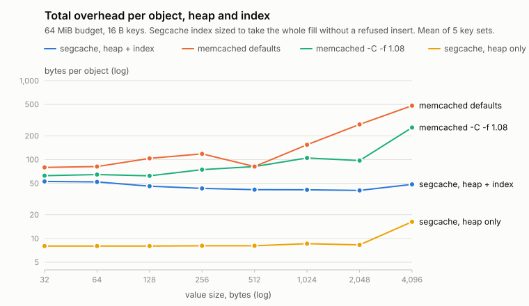

# segcache-lab

Segcache (Yang, Yue, Rashmi, NSDI '21) studied through its current
implementation. Each mechanism is read in source, measured against the paper's
claims and against memcached 1.6, and then changed.

The engine under test is the `segcache` crate in
[pelikan-io/cache-rs](https://github.com/pelikan-io/cache-rs), which
[pelikan](https://github.com/pelikan-io/pelikan) has embedded since its PR
#189. The harness drives the engine in-process and memcached as a native
process. Nothing is reimplemented: every measurement runs upstream code built
from the commits in `notes/repos.md`.

## Results

| # | question | result | details |
|---|---|---|---|
| 01 | What does one object cost, index included, at a fixed memory budget? | Both engines store exactly the count derived from their source, at every size and in every config. Segcache's heap overhead is 8 B per object for values up to 512 B, close to the paper's 5 B. Its fixed-size, first-fit two-choice index refuses inserts from 25–55% occupancy, so sizing it to never refuse costs another 32–45 B per object. Index included, segcache's overhead is 40.7–52.8 B per object against memcached's 62.3–482.6 B. At 32 B values it is 16% below memcached tuned with `-C -f 1.08`. | [RESULTS](experiments/01-metadata-overhead/RESULTS.md) · [prediction](experiments/01-metadata-overhead/PREDICTION.md) |

<picture>
  <source media="(prefers-color-scheme: dark)" srcset="experiments/01-metadata-overhead/figures/01-total-overhead-dark.svg">
  
</picture>

## Optimization targets, ranked by total effect

Sixteen candidate changes are mapped in [Stop 2](notes/stop-2-hot-paths.md).
[Stop 3](notes/stop-3-amdahl.md) ranks them by what they can move overall,
not by local cost:

1. **TTL floor.** Max-ages of 1–7 s live 1 s, so for short-TTL traffic an
   object's miss ratio rises 1.5× to 4.5×. Negligible for TTLs of minutes or
   more.
2. **Index placement and sizing.** First-fit two-choice placement in a
   power-of-two table. Least-loaded placement in an exactly sized table holds
   1.50× as many objects per byte at 32 B values and 1.33× at 64 B.
3. **Shared-line atomics on the read path.** The frequency RNG word, slot
   CAS, reader pins and metrics counters. Their cost under threads is
   pending measurement.
4. **Instruction-level work.** The ghost rescan, NEON tag mask and insert
   rescans: at most 23% of engine instructions, which is a small share of a
   networked request.

## Source notes

| stop | covers | file |
|---|---|---|
| 1 | Item, segment and index layout in both engines; paper vs C artifact vs Rust; where cache-rs's docs and code disagree | [notes/stop-1-layout.md](notes/stop-1-layout.md) |
| 2 | Exact instructions per operation by component and source line; sixteen targets pinned to the structures they live in | [notes/stop-2-hot-paths.md](notes/stop-2-hot-paths.md) · [target map](notes/target-map.svg) |
| 3 | Amdahl budget: each target judged against memory, misses and CPU; timed half pending AC power | [notes/stop-3-amdahl.md](notes/stop-3-amdahl.md) |

## What you run

```bash
make fetch     # clone upstreams at pinned commits, build memcached 1.6.45
make verify    # 14 invariant checks on the model and both engines
make exp01     # experiment 01 end to end, about 8 minutes on an M4 Pro
make vm        # arm64 Linux VM with valgrind, for exact profiles
make cachegrind           # instructions per operation, by component and line
make samply OP=get-miss   # native call stacks in the Firefox Profiler
```

This needs cargo (the toolchain is pinned in `rust-toolchain.toml`), a C
toolchain, autotools, libevent and python3. The experiment scripts use the
Python standard library only. `repos/` and `papers/dl/` are not committed.
`notes/repos.md` lists every clone with its commit, and `papers/README.md`
gives the paper's URL and SHA-256.

## What you get

| path | contents |
|---|---|
| `notes/` | crawl notes on the source, cited `file:line` at pinned commits |
| `experiments/NN-name/` | `PREDICTION.md` (committed before the run), driver, raw CSVs, `RESULTS.md`, figures |
| `harness/` | Rust crate: `capacity` (one measurement, one CSV row), `predict` (the source-derived model), `verify`, `profile` (single-operation workloads for profilers) |
| `profiles/` | per-build instruction counts: `ops.csv`, `components.csv`, `lines.csv`, annotated source per operation |
| `env/host.md` | host description, and which experiments it can and cannot support |
| `scripts/` | fetch, memcached build, host report |

## How results are kept honest

- Every experiment commits its prediction before it runs, and lists any runs
  made before the prediction was written.
- The capacity model is code. `make verify` checks it against the engine's own
  size function and against the slab table memcached prints.
- Each point uses five disjoint key sets, because both engines hash with fixed
  seeds.
- Corrections stay in the record. Stop 1 originally misread the index size by
  8×; the error and how it was caught are in the note and its commit.

## Not measured yet

- **Throughput and latency.** This host is macOS on Apple silicon, with no core
  affinity and mixed core types. Timing claims are bounded, and thread scaling
  (planned experiment 06) needs a Linux host. See `env/host.md`.
- **Expiry behaviour (02, 03).** `make verify` already pins the TTL bucket
  floor exactly: a 10 s TTL lives 8 s, and 1–7 s TTLs live 1 s
  (`notes/stop-1-layout.md`, harness `model.rs`). The memory and hit-ratio
  consequences are not measured yet.
- **Changes to the engine.** Sixteen candidates are mapped in Stop 2. None is
  applied yet.
- **Multi-threaded contention.** Stop 2 confirms three shared-line writes on
  the read path (the frequency RNG word, the frequency CAS, the reader pin).
  Their cost under threads is unmeasured.

## Licence

MIT, see `LICENSE`. Upstream projects keep their own licences; none of their
source is in this repository.
