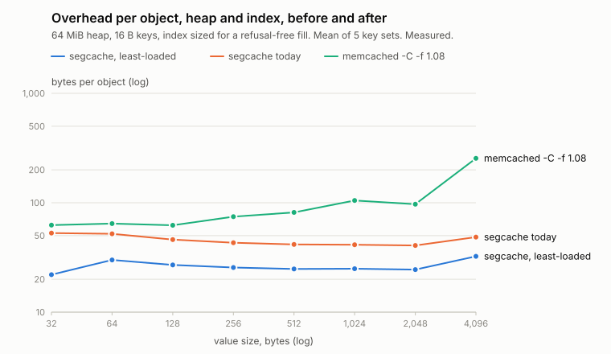
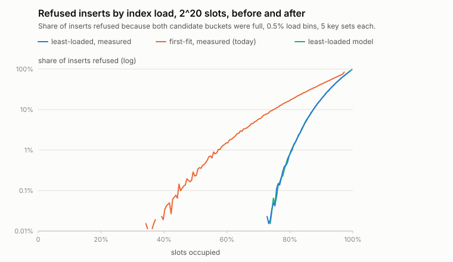

# Change 01: least-loaded placement in the hash index, results

The change places a new key in the less-occupied of its two candidate buckets.
cache-rs's documentation already describes that behaviour. It raises the load
at which the index first refuses an insert from 0.30–0.55 to 0.71–0.80. Sized
for a refusal-free fill, the index then needs one power of two fewer slots at
every value size. Overhead per object falls from 52.8 to 22.0 B at 32 B
values, which is 1.44× as many objects in the same memory.

The cost is in instructions. Holding the same objects, a hit costs 22 more
and a new-key insert 299 more. In exchange, the smaller index removes nearly
all simulated last-level misses on hits. cache-rs's own test and concurrency
suites pass unchanged.

Patches against cache-rs `4620d7e`:

- `0001-least-loaded-claim.patch` changes placement.
- `0002-single-pass-claim.patch` cuts the insert cost of 0001 and leaves
  placement identical.

Predictions are in `PREDICTION.md`, committed before each measurement.
All counts were taken on 2026-11-22. Capacity was measured natively and
instruction counts in the arm64 VM (Stop 2's method). No timing is reported.

## Correctness

cache-rs's suites, run with `scripts/cache-rs-tests.sh`. Logs are in `tests/`.

| build | default | debug feature | shuttle models |
|---|---:|---:|---:|
| pinned commit | 218 passed | 219 passed | 10 passed |
| + 0001 | 218 passed | 219 passed | 10 passed |
| + 0001 + 0002 | 218 passed | 219 passed | 10 passed |

No test asserted first-fit order. All 13 of `make verify`'s checks pass
against both patched builds (`verify.log`, `verify-0002.log`). The fit search
ran 295 times with nothing lost, nothing corrupted and no unexpected errors.

## Capacity

Same procedure as experiment 01. Placement is identical under 0001 and
0001+0002: all 296 fit-search rows and 2,998 refusal-curve rows match.

| value B | fit power before | after | stored objects | overhead before | after | objects per byte |
|---:|---:|---:|:---:|---:|---:|---:|
| 32 | 22–23 | 21 | unchanged | 52.8 | 22.0 | 1.44× |
| 64 | 22 | 21 | unchanged | 52.0 | 30.0 | 1.20× |
| 128 | 21 | 20 | unchanged | 46.0 | 27.0 | 1.11× |
| 256 | 20 | 19 | unchanged | 43.1 | 25.6 | 1.06× |
| 512 | 19 | 18 | unchanged | 41.6 | 24.8 | 1.03× |
| 1024 | 18 | 17 | unchanged | 41.3 | 25.0 | 1.02× |
| 2048 | 17 | 16 | unchanged | 40.7 | 24.5 | 1.01× |
| 4096 | 16 | 15 | unchanged | 48.5 | 32.4 | 1.00× |

Overhead is in bytes per object, heap plus index, mean of five key sets.

<picture>
  <source media="(prefers-color-scheme: dark)" srcset="figures/c01-overhead-dark.svg">
  
</picture>

First-refusal load, mean of five key sets:

| hash_power | first-fit | least-loaded | min | max | least-loaded model |
|---:|---:|---:|---:|---:|---:|
| 13 | 0.461 | 0.793 | 0.738 | 0.825 | 0.763 |
| 14 | 0.470 | 0.776 | 0.767 | 0.783 | 0.758 |
| 15 | 0.417 | 0.756 | 0.735 | 0.778 | 0.757 |
| 16 | 0.375 | 0.759 | 0.730 | 0.775 | 0.763 |
| 17 | 0.358 | 0.738 | 0.698 | 0.761 | 0.733 |
| 18 | 0.349 | 0.728 | 0.693 | 0.752 | 0.742 |
| 19 | 0.343 | 0.730 | 0.717 | 0.745 | 0.722 |
| 20 | 0.304 | 0.711 | 0.697 | 0.725 | 0.722 |

The refused share of inserts now reaches 1% at 0.805–0.810 load and 10% at
0.870–0.880, against 0.565–0.570 and 0.745–0.755 before. The measured curve
lies on the least-loaded model.

<picture>
  <source media="(prefers-color-scheme: dark)" srcset="figures/c01-refusals-dark.svg">
  
</picture>

## Cost per operation

Instructions per operation, `+lse` build. The first three columns use the
Stop 2 workload, about 7% slot load, where most placements are ties.

| operation | pinned | + 0001 | + 0001 + 0002 |
|---|---:|---:|---:|
| get, hit | 454.0 | 464.2 | 464.2 |
| get, miss | 435.0 | 435.0 | 435.0 |
| insert, new key | 1,076.4 | 1,291.4 | 1,208.2 |
| insert, replace | 721.0 | 727.3 | 730.3 |
| delete | 884.2 | 896.1 | 896.1 |

The next table holds the object count fixed instead: 140,000 prefilled,
40,000 operations, 180,000 at the end. Each engine uses the index it needs
for a refusal-free fill. First-fit needs 2^20 slots (8 MiB, 17% full) and
least-loaded 2^18 (2 MiB, 69% full). Last-level misses come from
cachegrind's model of a 16 MiB L2.

| operation | first-fit, 2^20 | least-loaded, 2^18 | LL misses first-fit | LL misses least-loaded |
|---|---:|---:|---:|---:|
| get, hit | 454.0 | 476.1 | 0.40 | 0.00 |
| get, miss | 435.0 | 435.2 | 0.06 | 0.00 |
| insert, new key | 1,089.4 | 1,388.2 | 0.80 | 0.71 |

The new-key cost at 69% load comes from the claim loop walking further to
find an empty slot. A first-fit index never runs that full. For the 80/10/10
hit/miss/insert mix of Stop 3 at this load, the change adds about 48
instructions per operation, +9%. In exchange it removes an average of 0.40
last-level misses per hit. Whether time per operation rises or falls is a timed
measurement, pending AC power.

## Prediction scorecard

| | prediction | outcome |
|---|---|---|
| P1 | suites pass except first-fit-order tests | held. All pass; no test asserted first-fit order |
| P2 | first-refusal load within 0.05 of the model | held at 2^13 to 2^20, largest gap +0.030. 2^21 and up was not reached: every size fit below it |
| P3 | fit power by size | held exactly at all eight sizes. 64 B fit at 2^21, the borderline case |
| P4 | stored objects unchanged | held, all 40 fits |
| P5 | overhead 22.0 B at 32 B, 27.0 B at 128 B; 64 B 19.0 or 30.0 B | held exactly: 22.0, 27.0, and 30.0 (the 2^21 branch) |
| P6 | 1% refused at 0.80 ± 0.03, 10% at 0.87 ± 0.03 | held: 0.805–0.810 and 0.870–0.880 |
| P7 | hit +≤30, miss ±5, new-key insert +20 to 60, replace and delete ±30 | **failed on new-key insert:** +215. The rest held |
| P8 | `make verify` passes | held, 13 of 13 |
| Q1 | 0002 places exactly as 0001 | held, all rows identical |
| Q2 | 0002 new-key insert +40 to 90 over pinned | **failed:** +131.7. The scalar pass over 16 slots costs more than estimated |
| Q3 | other operations within ±5 of 0001 | held: 0.0, 0.0, +3.0, 0.0 |
| Q4 | suites and verify pass | held |
| R1 | at the same object count, hit +≤40 | held: +22.1 |
| R2 | LL misses per hit no higher | held: 0.40 to 0.00 |
| R3 | miss within ±5 | held: +0.2 |

Correction: earlier commits and the README said `make verify` runs 14
checks. It runs 13.

## Limits

- Occupancy is read with relaxed loads, so concurrent inserts can see stale
  counts. That affects balance, not correctness, and the shuttle models pass.
  Placement quality under many writer threads is not measured.
- The new-key cost is load dependent and is measured at 7% and 69%
  occupancy only.
- A NEON version of the claim scan is the obvious next step for the insert
  cost (Stop 2, target 3's technique). It is not attempted here.
- Capacity gains are measured at a fixed 64 MiB heap with one value size per
  fill, as in experiment 01.
