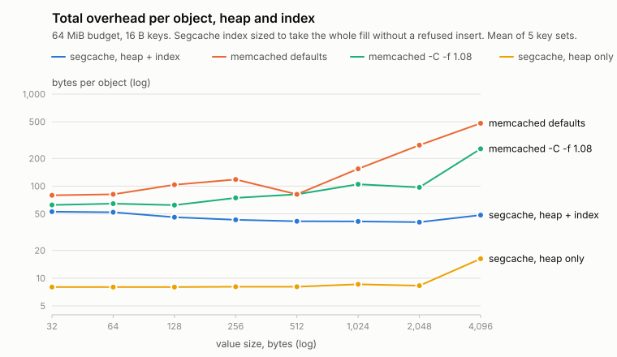
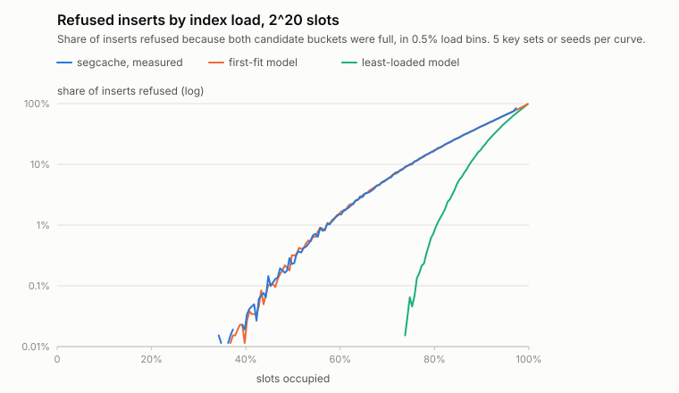
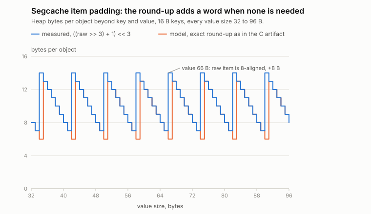
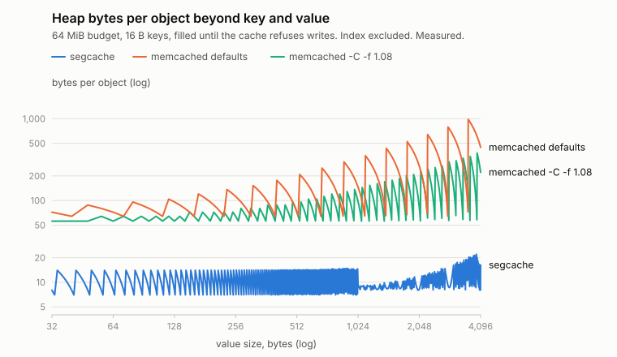

# 01 metadata overhead: results

Run 2026-11-22 on the host in `env/host.md` (M4 Pro, AC power). Engines:
cache-rs `4620d7e` (segcache 0.4.5) and memcached 1.6.45. Method and
predictions: `PREDICTION.md`, committed before this run. Wall time 7 min 50 s.

## Setup

16 B keys, fixed-size values, no expiry, 64 MiB data budget. Each run fills
one engine until it refuses writes, then reads back every key written.
Segcache runs in-process with `Policy::None` and 1 MiB segments. memcached
runs with `-M`. Five disjoint key sets per point.

- **Primary sweep** (`results.csv`, 458 runs): values 32 to 4096 B in powers
  of two. Three memcached configs. Segcache at every `hash_power` from 12 up to
  the first that takes the whole fill without a refused insert (the **fit**
  power).
- **Fine sweep** (`sweep.csv`, 2,395 runs): segcache at every value size from
  32 to 1024 B, then every 8 B to 4096 B, with an index too large to bind.
  memcached every 8 B.
- **Refusal curves** (`refusals.csv`, 15 runs): insert outcomes in 0.5% slot
  load bins at `hash_power` 16, 18 and 20.

## Integrity

None of the 2,868 runs lost an acknowledged object, returned a byte that
differed from what was written, evicted, or raised an unexpected error. In
every run, the keys found on read-back equal the keys acknowledged.

## Findings

**1. Both engines store exactly the count derived from their source.** All
160 primary configurations (4 configs × 8 sizes × 5 key sets) match the model
to the object. memcached gives every 1 MiB page of `-m 64` to the item's slab
class. Segcache fills each 1 MiB segment with floor(1 MiB / item) items.

**2. Counting the index changes the comparison.** Segcache's heap overhead
beyond key and value is 8.0 B per object at 32 to 512 B. That is the paper's
accounting. Its fixed-size index has to be sized before any data arrives, and
sizing it to take the whole fill without a refused insert costs 32 to 45 B
per object. That is 66% to 85% of segcache's total overhead.

<picture>
  <source media="(prefers-color-scheme: dark)" srcset="figures/01-total-overhead-dark.svg">
  
</picture>

| value B | segcache heap only | segcache heap + fit index | memcached defaults | memcached `-C` | memcached `-C -f 1.08` |
|---:|---:|---:|---:|---:|---:|
| 32 | 8.0 | 52.8 (36.0–64.0) | 79.5 | 79.5 | 62.5 |
| 64 | 8.0 | 52.0 | 81.5 | 81.5 | 64.5 |
| 128 | 8.0 | 46.0 | 103.5 | 103.5 | 62.3 |
| 256 | 8.1 | 43.1 | 118.1 | 118.1 | 74.6 |
| 512 | 8.1 | 41.6 | 81.6 | 81.6 | 81.6 |
| 1024 | 8.6 | 41.3 | 154.1 | 154.1 | 104.9 |
| 2048 | 8.3 | 40.7 | 279.2 | 279.2 | 97.1 |
| 4096 | 16.3 | 48.5 | 482.6 | 482.6 | 254.8 |

Bytes per object, mean of 5 key sets, all inclusive: (heap budget + index) /
objects − key − value. The range shown is across key sets; every other cell
has a spread below 0.05 B. At 32 B, segcache stores 2.14× as many objects as
memcached at defaults and 1.86× as many as memcached with `-C -f 1.08`. Its
overhead per object is 34% and 16% lower respectively.

**3. The index refuses inserts at 25% to 55% occupancy.** A fresh key takes
the first of its two candidate buckets that has a free slot
(`hashtable/table.rs:1304-1310`). There is no overflow chain, so when both are
full the insert is refused. The load at the first refusal falls as the table
grows, and the engine tracks an idealised first-fit model throughout. The same
model with least-loaded placement, which cache-rs's documentation describes,
holds to 0.68–0.76 at these sizes. Selected rows below; `analyze.py` prints
all eleven.

| hash_power | slots | key sets | measured mean | min | max | first-fit model mean |
|---:|---:|---:|---:|---:|---:|---:|
| 12 | 4,096 | 5 | 0.551 | 0.492 | 0.594 | |
| 14 | 16,384 | 5 | 0.470 | 0.323 | 0.547 | 0.469 |
| 16 | 65,536 | 5 | 0.375 | 0.364 | 0.392 | 0.403 |
| 18 | 262,144 | 5 | 0.349 | 0.318 | 0.391 | 0.377 |
| 20 | 1,048,576 | 5 | 0.304 | 0.288 | 0.341 | 0.314 |
| 22 | 4,194,304 | 3 | 0.253 | 0.246 | 0.265 | 0.280 |

Past the first refusal, the share of inserts refused tracks the first-fit
model to within bin noise. In the engine it reaches 1% at 56.5–57% load and
10% at 74.5–75.5%, at all three table sizes. The least-loaded model reaches
those shares at 80% and 87%.

<picture>
  <source media="(prefers-color-scheme: dark)" srcset="figures/01-refusals-p20-dark.svg">
  
</picture>

**4. The default index caps a 64 MiB cache.** `hash_power` counts slots
(`table.rs:182-189`), so the default 16 is 65,536 slots in 512 KiB. Up to
512 B values, the cache saturates at 65,533–65,536 objects after refusing
50,178–59,546 inserts. At 32 B that is 5.5% of the objects its heap can hold;
at 512 B it is 52%. At 1024 B it stores 59,659–59,783 of 64,000. At 2048 B,
5 to 9 inserts are refused. At 4096 B none are.

**5. One value size in eight pays 8 B more than the C artifact.** The item
round-up `((raw >> 3) + 1) << 3` (`crates/keyvalue/src/item/mod.rs:44`) adds a
full word when the raw item is already 8-aligned. Across every value size from
32 to 1024 B, in-heap overhead repeats with period 8 between 7 and 14 B. The
maximum, 14 B, falls exactly where `vlen ≡ 2 (mod 8)` for 16 B keys. The C
artifact's exact round-up (`item.h:151`) would store 6 B there. Each residue
class spans at most 0.77 B, which is segment-tail waste.

<picture>
  <source media="(prefers-color-scheme: dark)" srcset="figures/01-roundup-dark.svg">
  
</picture>

**6. Slab rounding dominates memcached above a few hundred bytes.** At
factor 1.25, the unused part of a chunk reaches 20.3% (value 3,560 B: a
3,635 B item in a 4,544 B chunk). At `-f 1.08` it peaks at 9.6%. `-C` saves
8 B per item, but at every power-of-two size here the item stayed in the same
slab class, so capacity did not change. Segcache's segment-tail waste is the
analogue: it reaches 8.3 B per object at 4096 B, because 254 items of 4,120 B
leave 2,096 B of each 1 MiB segment unused.

<picture>
  <source media="(prefers-color-scheme: dark)" srcset="figures/01-heap-overhead-dark.svg">
  
</picture>

**7. memcached's index lags its contents by seconds.** Growth is checked once
per clock tick (`memcached.c:3938`), one power at a time. After a fill of
559,232 items, all of them sat on 2^16 buckets (8.5 items per chain) until
the table settled at 2^19, 2.56 to 2.67 s later. Settled, memcached's index
costs 6.0 to 9.5 B per object up to 512 B.

## Prediction scorecard

| | prediction | outcome |
|---|---|---|
| P1 | memcached capacity equals the model exactly | held: 120 of 120 runs |
| P2 | segcache fit capacity equals the model exactly | held: 40 of 40 |
| P3 | nothing lost or corrupted | held: 0 in 2,868 runs |
| P4 | fit `hash_power` per size, within one power | held. Exact at 7 of 8 sizes. At 32 B, 2 of 5 key sets fit at 22 instead of the predicted 23 |
| P5 | default index refuses at every size up to 2048 B, none at 4096 B | held |
| P6 | at 32 B, segcache 64.0 B; within 25% of memcached; index 87% of its overhead | partly held. Mean 52.8 B (36.0 to 64.0 by key set, see P4). 16% below tuned memcached, but 34% below defaults, outside the predicted 25%. Index share 85% |
| P7 | segcache item − key − value is 8 B at powers of two | held as stated. Measured heap overhead also includes segment-tail waste: 0.1 to 8.3 B from 256 B up. The prediction table included it; the P7 sentence did not mention it |
| P8 | period-8 heap overhead, 7 to 14 B, peak at `vlen ≡ 2 (mod 8)`; memcached teeth to about 20% | held: 7.00 to 14.77 B; memcached 20.3% |
| P9 | engine refusal curve follows the first-fit model; least-loaded about 0.7 | held |

## Limits

- Fixed-size values in each fill. Mixed sizes would bring in memcached's slab
  rebalancing and segcache's per-segment tail effects in combination. Not
  measured here.
- Capacity is measured at the first space refusal, not under steady-state
  eviction. With eviction, index load follows the resident object count, and
  the refusal curve gives the rate at that load.
- "Fit" is the strictest index criterion: zero refused inserts during the
  whole fill. A cache that tolerates some refused sets can run its index
  fuller. Because `hash_power` moves in powers of two, the 1%-refusal criterion
  still lands on the same power for most sizes here.
- The placement model draws two independent buckets. The engine derives both
  from one 64-bit hash (`table.rs:266-278`). The measured curves sit inside
  the model's seed-to-seed range at every table size.
- Items stored with TTL 0 go to segcache's last TTL bucket (about 97 days,
  `segcache.rs:1337-1340`). Nothing expired during a run.
- The RSS of each run is recorded in the CSVs but not analysed. On macOS,
  segcache's heap pages are touched lazily, so RSS does not reflect the
  configured heap.

## Reproduce

```bash
make fetch verify exp01
python3 experiments/01-metadata-overhead/analyze.py   # tables above
python3 experiments/01-metadata-overhead/plot.py      # figures/
```

Counts are deterministic for a given key set. `make verify` asserts it for
three configurations. A rerun of 22 primary configurations reproduced every
count: key set 0, values 32, 512 and 4096 B, every memcached config and every
segcache `hash_power` from 16 up.

## Files

| file | contents |
|---|---|
| `PREDICTION.md`, `prediction.csv` | predictions, committed before the run |
| `run.py` | the driver |
| `results.csv` | primary sweep, one row per run |
| `sweep.csv` | fine value-size sweep |
| `refusals.csv`, `model-refusals.csv`, `model-loads.csv` | index refusal data, measured and modelled |
| `analyze.py`, `summary.csv` | tables in this file |
| `plot.py`, `figures/` | figures, light and dark |
