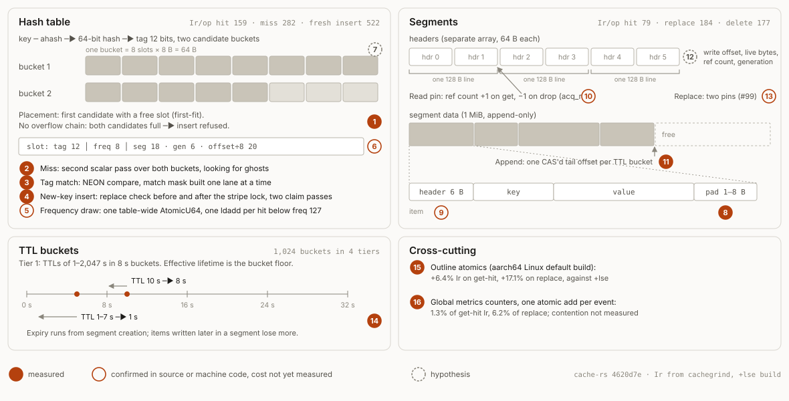

# Stop 2: hot paths, instruction by instruction

Where each operation spends its instructions, measured exactly, and the
mechanisms behind the largest costs. The targets are drawn in
[target-map.svg](target-map.svg). Citations are `file:line` at cache-rs
`4620d7e`.



## Method

valgrind does not run on macOS arm64, so exact counts come from cachegrind in
an Ubuntu 24.04 arm64 VM (Lima, `make vm`). Valgrind is 3.22.0 and rustc is
1.100.0, pinned. Instruction counts are simulated, so the VM does not
perturb them.

- `harness/src/bin/profile.rs` runs one operation type 100,000 times over a
  cache prefilled with 200,000 objects. Keys are 16 B, values 64 B, the heap is
  256 MiB and the index has 2^22 slots, so occupancy stays far below the
  first-fit refusal point. Every outcome is checked.
- `scripts/cachegrind.sh` profiles each operation twice: in full, and with
  `--skip-phase`, which does everything except the measured loop. The
  difference is the loop alone, exact to the instruction. Cachegrind attributes
  cost by instruction address, so inlined code is charged to the source line it
  came from.
- Simulated caches use the M4 Pro performance core's geometry. Miss counts are
  a model, not a hardware measurement, and are reported only in
  `profiles/*/ops.csv`.

**Why not callgrind.** Callgrind's call tracking misreads arm64 tail calls. It
reported `phase_get_hit` re-entering itself through `Segcache::get`, so
`--toggle-collect` switched collection off mid-phase and returned 10
instructions for a get that costs 454. Its inclusive costs were inconsistent
too, with a callee reported at 200,000% of the program total. The
differential cachegrind method needs no call tracking.

**Native call stacks.** `make samply OP=<op>` records with samply on macOS and
opens the Firefox Profiler.

## Instructions per operation

Three builds of the same workload:

| operation | `+lse` | Linux default | `+lse`, no metrics |
|---|---:|---:|---:|
| get, hit | 454 | 483 (+6.4%) | 448 (−1.3%) |
| get, miss | 435 | 426 (−2.1%) | 434 (−0.2%) |
| insert, new key | 1,076 | 1,116 (+3.7%) | 1,064 (−1.1%) |
| insert, replace | 721 | 844 (+17.1%) | 676 (−6.2%) |
| delete | 884 | 994 (+12.4%) | 849 (−4.0%) |

`+lse` is `-C target-feature=+lse`. It inlines atomics as on macOS and
on LSE-tuned Linux builds. The aarch64 Linux default calls an out-of-line
helper (`__aarch64_ldadd8_relax` and others) for every atomic. "No metrics"
builds the engine without its default `metrics` feature.

By component, `+lse` build (`profiles/lse/components.csv`):

| component | get hit | get miss | insert new | insert replace | delete |
|---|---:|---:|---:|---:|---:|
| hash table | 159 | 282 | 522 | 174 | 320 |
| segments and pins | 79 | 0 | 31 | 184 | 177 |
| API and retry logic | 91 | 54 | 61 | 76 | 33 |
| atomics | 28 | 36 | 159 | 101 | 96 |
| other std inlines | 63 | 47 | 222 | 107 | 182 |
| everything else | 34 | 16 | 82 | 79 | 76 |

## Mechanisms confirmed

**A miss rescans its buckets for ghosts that cannot exist.** After the SIMD
scan reports no match, `lookup` walks both candidate buckets again with a
scalar loop (`hashtable/table.rs:1210-1213`, `:604-625`). It looks for ghost
entries to credit. Only S3-FIFO eviction creates ghosts (`convert_to_ghost`).
Under every other policy, including the default `Random`, the pass never finds
one. It costs 70 of the 435 instructions in a miss (16%).

**The NEON tag scan assembles its match mask one lane at a time.**
`find_tag_matches_simd` (`table.rs:369-463`) compares tags with vector
instructions, then extracts and shifts each of eight lanes to build a bitmask.
That is about 57 instructions per bucket scanned: 114 on a miss, which scans
both buckets.

**A fresh insert scans its buckets repeatedly.** 522 of its 1,076 instructions
are in the hash table:

- a replace check over both buckets, before the stripe lock and again after
  it (47)
- two scalar claim passes, one for ghosts and one for empty slots (62)
- bounds-checked `bucket()` calls (62)
- the NEON scans (54)

**Every hit below frequency 127 performs an atomic add on one word shared by
the whole table.** The frequency draw is evaluated as an argument
(`table.rs:557`), so it runs even when `try_update_freq` ignores it at
frequency ≤ 16 (`bucket.rs:112`). In the `+lse` build of `Segcache::get`:

```
cmp    w9, #0x7f              ; freq < 127 ?
b.cs   skip
add    x10, x20, #0x168       ; &table.freq_rng.state
cmp    w9, #0x11              ; freq <= 16 ?
ldadd  x23, x10, [x10]        ; shared fetch_add, every hit with freq < 127
b.cc   bump                   ; freq <= 16: draw unused
...    splitmix mixing
udiv   x11, x9, x10           ; draw % freq, freq > 16 only
...
bump:  casl x26, x10, [x9]    ; write the slot
```

The compiler moved the mixing arithmetic behind the branch but kept the atomic
in front of it. Single-threaded, the cost is a few instructions. With several
reader threads, the word's cache line moves between cores on every hit. That
is not yet measured.

**Reads write shared lines in two more places.** The frequency `casl` writes
the bucket's line. The reader pin adds to and subtracts from the segment
header's reference count with acquire-release atomics
(`segments/segments.rs:573-605`), and that header is shared by every item in
its segment.

## Targets

All sixteen, with evidence level and the change to try, are in
[target-map.svg](target-map.svg) and in the table below.

| # | target | evidence | cost |
|---:|---|---|---|
| 1 | first-fit placement, no overflow | measured (01) | refusals from 25–55% load; 32–45 B per object of index |
| 2 | ghost rescan on every miss | measured | 70 of 435 Ir per miss |
| 3 | NEON mask built lane by lane | measured | about 57 Ir per bucket scanned |
| 4 | fresh insert rescans its buckets | measured | 522 of 1,076 Ir in the hash table |
| 5 | shared frequency RNG atomic | machine code | one `ldadd` per hit below freq 127 |
| 6 | frequency CAS on reads | source | reads write the bucket line |
| 7 | 64 B buckets on a 128 B line | hypothesis | |
| 8 | round-up adds an unneeded word | measured (01) | 8 B in one value size of eight |
| 9 | 6 B header | source | 32-bit length where 24 suffice |
| 10 | reader pin on the segment header | machine code | two acq_rel atomics per get |
| 11 | one tail per TTL bucket | upstream (#85) | write throughput flat to 16 threads |
| 12 | segment headers share 128 B lines | hypothesis | |
| 13 | replace takes two pins | upstream (#99) | |
| 14 | TTL bucket floor | measured (verify) | TTL 1–7 s lives 1 s |
| 15 | outline atomics on aarch64 Linux | measured | +6.4% to +17.1% Ir |
| 16 | global metrics counters | measured | 1.3% to 6.2% Ir; contention unmeasured |

## Reproduce

```bash
make vm            # once
make cachegrind    # profiles/<build>/ops.csv, <op>.txt; raw/ is gitignored
python3 profiles/summarize.py lse linux-default lse-no-metrics
make samply OP=get-miss
```

`profiles/<build>/<op>.txt` is `cg_annotate`'s phase-only diff, with
functions and annotated source. The raw cachegrind files in
`profiles/<build>/raw/` open in kcachegrind or qcachegrind.
