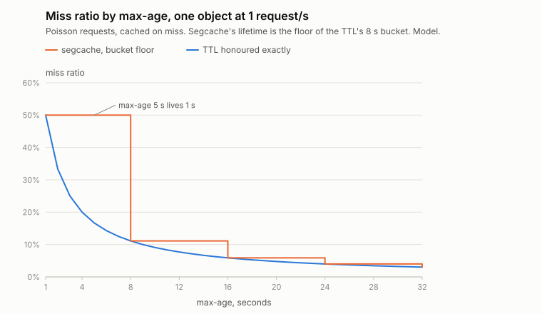
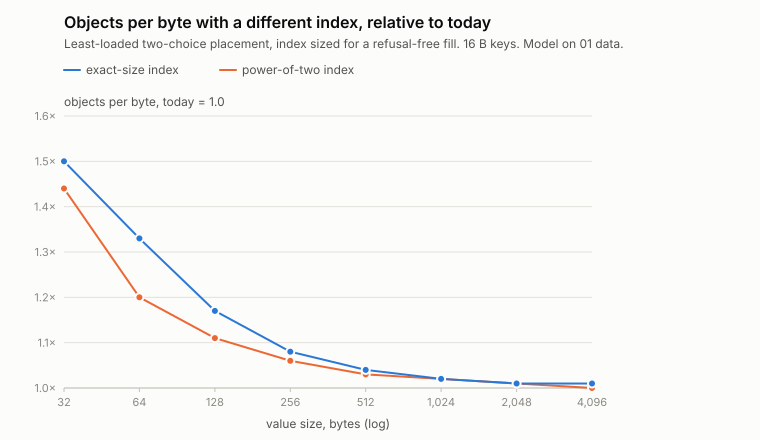
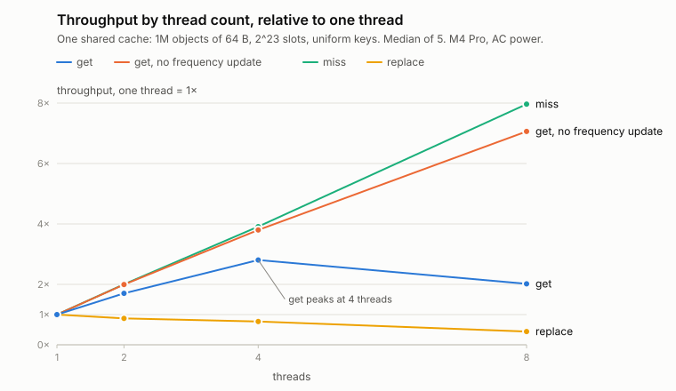

# Stop 3: an Amdahl budget

Stop 2 found sixteen changes, each with a local cost. This note asks which
one improves the system the most. Amdahl's law answers it: a change that
removes a fraction `s` of the work it touches, where that work is a fraction
`f` of the total, gives an overall speedup of `1 / ((1 − f) + f(1 − s))`.
Every target has to be judged against the denominator it actually shares.

A cache has three. **Memory** sets how many objects a server holds.
**Misses** set backend load and most of the end-to-end latency. **CPU**
sets throughput per core. The engine's instruction count touches only the
third, and only the part of it spent inside the engine.

The count-based half below needs no timing: it comes from experiment 01,
Stop 2 and the placement and cache models. `profiles/amdahl/model.py` prints
every table. The timed half was recorded as predictions, then run on AC
power at powermode 0 (`env/host.md`). Its results and a revised ranking
follow the predictions.

## Memory: objects per byte

Footprint per object is key + value + heap overhead + index share. The heap
overhead and today's index come from experiment 01. The index is sized to
take the fill without a refused insert, with first-fit placement and a
power-of-two table. The alternatives use the placement model's least-loaded
first-refusal load at the same table size, either in a power-of-two table
or in a table sized exactly to the load.

| value B | key+value | heap overhead | index now | footprint now | least-loaded, 2^p | least-loaded, exact size | gain, 2^p | gain, exact |
|---:|---:|---:|---:|---:|---:|---:|---:|---:|
| 32 | 48 | 8.0 | 44.8 | 100.8 | 14.0 | 11.3 | 1.44× | 1.50× |
| 64 | 80 | 8.0 | 44.0 | 132.0 | 22.0 | 11.3 | 1.20× | 1.33× |
| 128 | 144 | 8.0 | 38.0 | 190.0 | 19.0 | 11.1 | 1.11× | 1.17× |
| 256 | 272 | 8.1 | 35.0 | 315.1 | 17.5 | 11.1 | 1.06× | 1.08× |
| 512 | 528 | 8.1 | 33.5 | 569.6 | 16.8 | 10.8 | 1.03× | 1.04× |
| 1024 | 1040 | 8.6 | 32.8 | 1081.3 | 16.4 | 10.9 | 1.02× | 1.02× |
| 4096 | 4112 | 16.3 | 32.3 | 4160.5 | 16.1 | 10.6 | 1.00× | 1.01× |

The index is the only memory target with a large `f` for small values. The
item-level targets (exact round-up, 5 B header) save 8 B in one value size
of eight, about 1 B per object on average. The mean object sizes of
Twitter's top four clusters are 55 to 294 B, key plus value (paper §2.2).
That spans the 48 to 528 B rows above, where index placement and sizing are
worth 1.04× to 1.5× more objects in the same memory.

## Misses: the TTL floor

Every TTL below 2,048 s lives to the floor of its 8 s bucket, and every TTL
from 1 to 7 s lives 1 s (Stop 1, verified exactly by `make verify`). Take one
object whose requests arrive as a Poisson process at rate λ, cached on miss
for lifetime T. Its hit ratio is λT / (1 + λT). Segment age, which shortens
lifetimes further for items written later into an open segment, is ignored,
so the floored column is an upper bound on hits.

| max-age s | lifetime s | miss ratio at 0.1 req/s | 1 req/s | 10 req/s |
|---:|---:|---:|---:|---:|
| 2 | 1 | 83.3% → 90.9% | 33.3% → 50.0% | 4.8% → 9.1% |
| 5 | 1 | 66.7% → 90.9% | 16.7% → 50.0% | 2.0% → 9.1% |
| 7 | 1 | 58.8% → 90.9% | 12.5% → 50.0% | 1.4% → 9.1% |
| 10 | 8 | 50.0% → 55.6% | 9.1% → 11.1% | 1.0% → 1.2% |
| 15 | 8 | 40.0% → 55.6% | 6.2% → 11.1% | 0.7% → 1.2% |
| 60 | 56 | 14.3% → 15.2% | 1.6% → 1.8% | 0.2% → 0.2% |
| 300 | 296 | 3.2% → 3.3% | 0.3% → 0.3% | 0.0% → 0.0% |

For max-ages of a few seconds, the floor multiplies an object's miss ratio by
1.5 to 4.5, and the factor is largest for the most popular objects. Short
max-ages are common in HTTP microcaching. The paper's evaluation traces use
TTLs from 2 minutes to 30 days, mostly 12 hours or more (Table 3, PDF p. 9).
At those TTLs the effect is under 1.1×.

The fix has a memory cost. Narrower tier-1 buckets mean more TTL buckets with
an open, partly filled segment at once. Experiment 03 measures both sides.

## Misses: capacity converted to miss ratio

A capacity gain lowers misses through the workload's miss-ratio curve. As an
illustration only, take LRU under independent Zipf requests over 10M objects,
using Che's approximation (solver cross-checked against a log-space
bisection: same values to four decimals). Experiment 04 replaces this with
traces.

| alpha | cache holds | miss ratio | ×1.20 capacity | ×1.33 | ×1.44 |
|---:|---:|---:|---:|---:|---:|
| 0.8 | 2% | 69.3% | 67.6% (−3%) | 66.6% (−4%) | 65.8% (−5%) |
| 0.8 | 10% | 50.2% | 47.4% (−6%) | 45.7% (−9%) | 44.4% (−12%) |
| 1.0 | 2% | 30.9% | 29.6% (−4%) | 28.8% (−7%) | 28.3% (−8%) |
| 1.0 | 10% | 19.0% | 17.6% (−7%) | 16.8% (−12%) | 16.2% (−15%) |

## CPU: instructions for an operation mix

The mix is 80% hits, 10% misses and 10% new-key inserts, costing 514
instructions per operation in the `+lse` build (Stop 2). Each row is an upper
bound: the target's instructions if they fell to zero.

| target | instructions per op | share of the mix |
|---|---:|---:|
| 3 NEON tag scan, all of it | 68.6 | 13.3% |
| 15 outline atomics, default build vs `+lse` | 26.3 | 5.1% |
| 4 insert rescans: replace checks and claim passes | 11.0 | 2.1% |
| 2 ghost pass, all of it | 7.0 | 1.4% |
| 16 metrics counters | 6.1 | 1.2% |

Together they bound a 23% cut in engine instructions. Instructions are only
part of an operation's time: a get against a DRAM-sized working set waits on
one or two cache misses (Stop 2 simulates 1.25 last-level misses per hit).
In a networked server, the engine is in turn only part of each request.
Both denominators are timed measurements, below.

## Timed half: predictions, recorded before the runs

`profiles/amdahl/run.py` measures three things natively:

- **Latency split.** Single-thread ns per operation against a cache-resident
  working set (1,024 objects, 2^13 slots) and a DRAM-sized one (4M objects,
  2^24 slots, about 480 MB).
- **Read scaling.** 1, 2, 4 and 8 threads sharing one cache, for `get`
  (frequency update), `get_no_freq_incr` (the same lookup without it), misses
  and replaces. Each is built with and without the engine's metrics feature.
  `get` against `get_no_freq_incr` isolates targets 5 and 6. With metrics
  against without isolates target 16.
- **Network share.** memcached 1.6.45 with one worker thread over loopback:
  server CPU per get, unpipelined and in batches of 32.

Two smoke runs were made before these predictions, on battery in Low Power
Mode, so their timings are indicative only:

- `scale --op get --threads 2`: 9.0 M gets/s, 222 ns per thread per get.
- `rtt --batch 1 --clients 2`: 7.8 µs of memcached CPU per get.

**T1.** Against the DRAM-sized working set, a single-thread get spends most of
its time waiting on memory. The cache-resident get takes at most 40% as long.

**T2.** From 1 to 8 threads, `get` with metrics scales less than 3×, and
`get_no_freq_incr` without metrics scales more than 5×. The gap is the serial
fraction added by atomics on shared lines: the RNG word, the slot CAS, the
global counters.

**T3.** Metrics alone cost at least 30% of `get_no_freq_incr` throughput at
8 threads.

**T4.** Batching 32 gets per request cuts memcached's server CPU per get at
least 5×. Unpipelined, the engine's lookup is under 10% of server CPU per
request.

## Timed half: results

Run on 2026-11-23 on AC power, powermode 0 (`profiles/amdahl/host.md`), with
the profiling VM stopped. Data: `latency.csv`, `scaling.csv`, `rtt.csv`.
Each cell is the median of five repetitions; ranges are in the CSVs.

**Latency, one thread, ns per operation** (default build, metrics on):

| working set | get | get, no frequency update | miss | replace |
|---|---:|---:|---:|---:|
| cached: 1,024 objects, 2^13 slots | 26.7 | 27.0 | 12.5 | 44.7 |
| DRAM: 4M objects, 2^24 slots | 143.6 | 144.2 | 70.9 | 152.8 |

**Throughput, one shared cache, millions of operations per second**
(1M objects of 64 B, 2^23 slots, uniform keys):

| operation | 1 thread | 2 | 4 | 8 | 8 threads over 1 |
|---|---:|---:|---:|---:|---:|
| get | 7.5 | 12.8 | 21.1 | 15.2 | 2.02× |
| get, no frequency update | 7.5 | 15.0 | 28.7 | 53.2 | 7.06× |
| miss | 15.9 | 31.8 | 62.0 | 126.3 | 7.96× |
| replace | 7.1 | 6.2 | 5.5 | 3.1 | 0.44× |

Without the metrics feature, every get, no-frequency-update and miss cell is
within its run-to-run range. Replace is not: 10.9 and 7.6 M/s at 2 and 4
threads, against 6.2 and 5.5 with metrics. At 8 threads the two builds agree.

**Network share:** memcached 1.6.45 with one worker thread over loopback.

| batch | clients | server CPU per get | gets per second |
|---:|---:|---:|---:|
| 1 | 1 | 5,301 ns | 67,737 |
| 1 | 4 | 4,470 ns | 150,213 |
| 1 | 8 | 5,825 ns | 166,870 |
| 32 | 8 | 398 ns | 3,332,744 |

### Scorecard

| | prediction | outcome |
|---|---|---|
| T1 | cached get at most 40% of a DRAM-set get | held: 26.7 against 143.6 ns, 19%. About 81% of a DRAM-set get is memory wait |
| T2 | get with metrics scales under 3× to 8 threads; get without frequency update or metrics over 5× | held: 2.02× and 7.12×. The stated cause was partly wrong: metrics play no part (T3) |
| T3 | metrics cost at least 30% of no-frequency-update throughput at 8 threads | **failed:** 0%, 53.2 against 53.2 M/s. The read path increments no counter (`get_pinned`, `segcache.rs:270`). The 6-instruction get-hit gap between the two builds in Stop 2 falls on lines with no counter, so it is code generation |
| T4 | batching 32 cuts server CPU per get at least 5×; the engine is under 10% of an unpipelined get | held: 14.6× (5,825 to 398 ns). The engine's get, 27 to 144 ns, is 0.5% to 2.7% of memcached's 5.3 µs |

### What the scaling shows

- **The frequency update is the read path's serial section.** Single-
  threaded, get and get-without-update cost the same (26.7 and 27.0 ns), so
  the update costs no measurable time alone. With threads it caps the cache:
  get peaks at 21.1 M/s at 4 threads and falls to 15.2 at 8, while the same
  lookup without the update reaches 53.2, 3.5× as much.
- **Why:** every hit on an item below frequency 127 does a `fetch_add` on one
  shared word (`hashtable/table.rs:557` evaluates `freq_rng.next_u64()`
  before `bucket.rs:112` tests `freq <= 16`; `rand.rs:57`). Hits at
  frequency 16 or below also CAS their index slot. In this run no key
  reaches 127, so every get takes the shared word. The C artifact draws only
  above 16 (`hashtable.c:684`). It attempts at most one update per item per
  second, using an indicator bit inside the frequency field (`hashtable.c:46`);
  that is the "smoothed" in the paper's ASFC. cache-rs has neither, although
  its `docs/s3fifo.md:78` refers to the smoothing. Separating the shared word
  from the slot CAS is change 02's measurement.
- **The fall from 4 to 8 threads** fits the shared line crossing between
  the two P-core clusters, which hold 4 cores each per `host.md`. This is
  not tested.
- **Reader pins** are the next serial cost. A hit pins its segment and a
  miss does not. Get-without-update reaches 7.06× at 8 threads and miss
  7.96×, which bounds the pins at about 11% here. Skewed keys concentrate
  hits on fewer segments, where the cost would be larger.
- **Writes do not scale at all.** Replace throughput falls with every
  thread added. This fits target 11: every writer to a TTL bucket CASes that
  bucket's one tail offset, and this run uses a single TTL. Upstream measured
  flat write throughput to 16 threads for the same reason (cache-rs #85).
  The stripe locks have not been excluded. Not tested here.
- **A crude bound for a mix.** Take reads and writes as separately capped
  at their 8-thread rates, so a mix with write share `w` runs at most
  `min(R / (1 − w), 3.1 / w)` M/s. Today R is 15.2, and reads bind below
  17% writes. At R = 53.2, writes bind above 5.5%. Fixing the read path
  raises the bound 3.5× at 1% and 5% writes, and 1.8× at 10%.

## Provisional ranking

By the total each change can move, before the timed half:

1. **TTL floor (14), for short-TTL traffic.** For max-ages under about 15 s
   it multiplies per-object miss ratio by 1.5 to 4.5. Misses dominate a
   cache's end-to-end cost, since a backend fetch takes milliseconds against
   microseconds for a hit. So for an HTTP microcache this is the largest
   effect in the engine. For TTLs of minutes or more it is negligible.
2. **Index placement and sizing (1).** 1.2× to 1.5× more objects per byte at
   32 to 64 B values, and 1.04× or less from 512 B up. In the Zipf model,
   1.33× capacity removes 4% to 12% of misses. This is the largest certain
   gain for small-object workloads.
3. **Shared-line atomics on the read path (5, 6, 10, 16).** Unknown until
   T2 and T3 are measured. If reads stop scaling at a few threads, this moves
   to the top for throughput per server.
4. **Instruction-level work (2, 3, 4, 15).** At most 23% of engine
   instructions for the mix above. If T4 holds, the engine is under 10% of a
   networked request's CPU, so these cap at about 2% of server CPU. They are
   worth doing when the engine runs in-process, for example inside an HTTP
   proxy, not as a fleet lever.

## Ranking after the timed half

1. **The frequency update on the read path (targets 5 and 6).** Measured:
   it caps the whole cache at 15.2 M gets/s at 8 threads, against 53.2 M/s
   for the same lookup without it. It binds wherever the engine sees more
   than about 15 M gets/s: in-process, or behind a pipelined server
   (memcached served 3.3 M gets/s per worker thread at batch 32). pelikan
   shares one store across its worker threads (`src/core/server/src/workers/
   worker.rs:80`, `:115`), so the cap applies to the server as deployed.
   cache-rs's own `CLAUDE.md` still describes reads as `&mut self` with one
   cache per thread; the code at the pin takes `&self`. Change 02.
2. **TTL floor (14), for short-TTL traffic.** Unchanged. Experiment 03.
3. **Index placement and sizing (1).** Least-loaded placement is done
   (`changes/01-index-placement`). It turned out to be a time win as well:
   0.68× the time per operation in a DRAM-sized set. Exact sizing remains,
   worth 1.20× to 1.33× at 64 B.
4. **Write-path scaling (11).** Replace throughput falls with threads. It
   binds after item 1 for write shares above about 5%. Consistent with one
   CAS'd tail per TTL bucket; not yet tested.
5. **Instruction-level work (2, 3, 4, 15).** Single-threaded, a DRAM-set get
   is about 81% memory wait. Behind a network, the engine is 0.5% to 2.7% of
   server CPU per unpipelined get. This work pays only in-process with a
   cache-resident working set.
6. **Metrics counters (16).** Removed from the list. No counter is
   incremented on the read path, and on writes they matter only at 2 to 4
   threads.

For a networked server the largest lever is outside the engine. Per-request
CPU falls 14.6× from batch 1 to batch 32.
